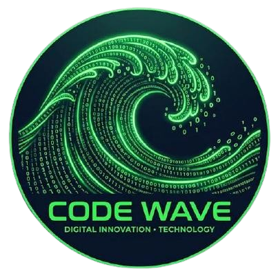

# STEAM ROBOT - API 1° Semestre ADS

  
  

  | <a href ="#desafio"> Desafio</a>  |
  <a href ="#solucao"> Solução</a>  |   
  <a href ="#backlog"> Backlog do Produto</a>  |
  <a href ="#dor">DoR</a>  |
  <a href ="#dod">DoD</a>  |

  

>Status da Sprint 1: Concluído ✅
>
>Vídeo da Sprint 1: [Vídeo ](https://youtu.be/gyAvtNEGqXM)🎥

## 🎯 Desafio 

O desafio consiste em desenvolver um chatbot no Telegram que tem como objetivo sanar dúvidas de novos desenvolvedores de jogos da Steam, a fim de facilitar para que eles saibam exatamente quais prioridades devem ter na criação de seus jogos e até mesmo qual é o momento ideal para lançá-los.

## 💡 Solução 

Com o Steam Robot, os usuários poderão escolher uma das opções fornecidas pelo chatbot, conseguindo assim um grande leque de conteúdos para facilitar a criação de seu projeto, podendo até mesmo comparar algumas informações e jogos para saber, de forma precisa, qual caminho devem seguir ao criar seu jogo.

## 📖 Backlog do Produto 

| Rank | Prioridade | User Stories | Story Points | Sprint |
|---:|:---:|---|---:|:---:|
| 1 | Alta | Como desenvolvedor, quero saber quais os gêneros de jogos mais populares no momento para preparar o meu jogo pro mercado. | 3 | 1 |
| 2 | Alta | Como desenvolvedor, quero saber a faixa de preço média que jogadores estão dispostos a partir com. Para precificar meu jogo apropriadamente. | 5 | 1 |

## 🥈 DoR - Definition of Ready 
* User Stories com **Critérios de Aceitação**
* Foi estimada pela equipe

## 🥇 DoD - 
* Código completo
* Manual do Usuário 
